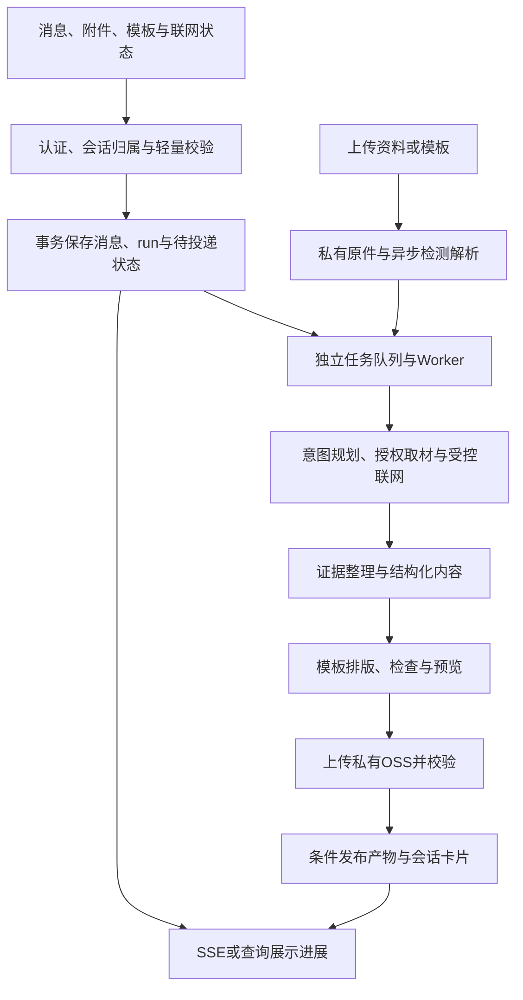

# 用户端统一智能助手实现方案（第二版）

修订日期：2026-11-02。状态：首版已进入实现与本地验证，具体交付范围及限制见[实现记录](unified-assistant-implementation.md)。本文件是完整目标设计，不能将每项设计视为已经验收。已吸收[团队审核意见](unified-assistant-review.md)，新增对话附件、管理端 PPT 模板库和用户上传模板。设计补齐不等于代码已修复或安全验收已通过。

## 1. 产品范围

用户只使用一个对话入口，自然语言完成知识问答、联网查询、上传参考资料、Word / PPT / Excel 生成和后续修改。保留现有智能问答入口与历史会话，不要求切换问答/文件模式。

输入框工具栏增加：

- “上传文件”：多文件上传，卡片区分“参考资料”和“PPT 模板”，详见第 11 节。
- “PPT 模板”：按需选择管理端已发布模板，也支持用户上传本次使用的模板；无模板时使用系统默认模板。
- “联网搜索”按钮：默认关闭；开启时高亮，文字显示“联网搜索 · 已开启”；再次点击关闭。
- “资料范围”：全部授权知识、当前文档、指定文档/目录。目录表示可用资料范围，不承诺已完整阅读全部内容。

三种格式通过自然语言指定，不增加三个常驻生成按钮。缺少格式时，助手只追问必要信息；有合理默认值时直接执行。对结果含义或范围存在实质歧义时再询问。复杂任务可以选择先看大纲，但不强制每次确认。

第一版以桌面用户端主问答入口为完整入口，移动端保留上传、模板选择、任务/文件卡片和下载的基础能力。Widget、独立 H5/微信入口逐个登记能否发起生成、读卡片和下载；共享消息解析与卡片组件，未开放的入口保持文字问答，不展示无效按钮。OpenAI 兼容接口继续保持已有文本会话语义，暂不默认触发新工具；后续通过明确扩展协议提供文件结果。

第一版文件在当前会话中展示，通过历史会话找回。文件集中管理页、共享、多人协作、在线 Office 编辑器、生成结果审核入库留作后续扩展。生成文件不自动发布到知识库，不自动触发学习。

对话上传同样不自动发布或学习，不改变知识库目录及权限。企业模板可用范围、模板管理权限和个人上传归属分别校验。

## 2. 用户可见流程

普通问题维持现有流式回答。需要生成文件时，助手先说明资料范围和计划产物，然后在原会话显示持久化任务卡片：

`等待处理 → 检查附件与模板 → 收集资料 → 整理内容 → 生成文件 → 检查文件 → 已完成`

卡片显示当前步骤、该步骤耗时、资料覆盖情况、失败原因和操作。仅展示真实步骤，不伪造百分比或“已找到”数量。

完成后显示文件名、格式、大小、版本、生成时间、实际引用来源，以及预览/下载/继续修改按钮。失败可重试，进行中可取消；源文件无权访问时显示限制状态。

修订必须关联指定基础产物版本。PPT 按稳定 slide ID 与当前版本页序；Excel 按工作表、列名或单元格范围；Word 首版按章节或段落定位。Word 页码随字体、排版软件变化，除非实现系统 PDF 页码与内容块映射，否则不承诺直接按“第三页”准确修改。旧版本保留；多文件指代不明时选择目标。

关闭页面或刷新不取消文件生成任务。恢复会话后通过服务端状态恢复卡片，不把旧 SSE 事件当成唯一任务记录。普通文字回答的停止与生成任务取消采用各自清楚的按钮语义。

任务接受后恢复聊天输入，后台卡片独立订阅，不占住整个聊天 loading 状态。首版每会话同时一个文件任务，其间可继续普通问答；对未完成产物的修订提示等待，或取消后重新提交。切换会话只停止展示订阅，不取消服务端任务。

## 3. 后端总体结构

复用现有 Go API、PostgreSQL、NATS、模型配置、知识权限、OSS、历史会话与问答日志；新增有边界的工具编排层，不引入无限循环的自主执行流程。

工具包括知识检索、知识原文读取、公网搜索/网页读取、文件创建和文件修订。是否允许联网由服务端验证的用户选择决定，模型不能自行打开开关。

旧普通文字问答保留现有流式路径；涉及文件或新增工具编排的请求在耗时规划、取材、附件等待与模型生成前先持久化 run。SSE 不拥有任务生命周期，不能等正文生成后才入队。

使用结构化计划和文件内容规范，服务端校验格式、工具参数、来源 ID 和规模限制。现有模型如支持稳定工具调用可以适配；也提供 JSON 结构化协议，不强依赖模型原生 Function Calling。格式修复次数有上限，模型能力用实际样本验证。

## 4. 知识取材与完整性

现有问答链路主要使用相关片段，文件任务新增按大纲分段检索和必要的原文读取，不直接把全部原文塞进单次模型请求。

- 指定文档：校验权限后读取对应生效版本；需要结构化数据时按权限读取原附件。
- 指定目录：先枚举可访问文档，建立取材清单，再分章节检索与阅读。
- 全部知识：按问题相关性选材，不宣称已覆盖整个知识库。
- 保存读取成功、解析不完整、未学习、缺失原文件和未覆盖的资料状态。
- 信息不足时明确列出缺项；没有依据的业务参数、价格、统计数字不得自动补造。
- 版本固定到取材时的已发布/生效版本，记录版本 ID；生成过程中权限变化仍需重新检查。
- 提交时冻结“当前文档”的节点与版本、目录可访问清单、附件哈希和模板版本；页面导航或偏好变化不改变已提交任务。
- 服务端按实际模型输入、历史消息、基础产物和检查点保守合并全部来源依赖，再加入新来源；依赖不限于用户可见引用，不由模型挑选需授权的来源。失权后不能只删除引用却保留受限正文。

对“完整汇总某目录”的任务，只有完成该目录可访问资料清单的处理，才声明完整；超出规模限制时应要求缩小范围或分批。

## 5. 联网搜索

### 按钮与会话规则

- 每个新会话默认关闭；服务端保存会话偏好。
- 发出消息时记录本轮开关快照，之后切换按钮不改变已提交任务的范围。
- 开启表示允许按需联网，不表示每条消息强制搜索。
- 未配置搜索服务或管理员禁用时按钮不可用，并说明原因。
- “关闭联网”指不进行公网检索，模型请求仍遵循现有模型服务配置。

### 检索与来源

引入搜索服务适配接口，第一版只接一家实际可访问的搜索 API；服务商和密钥在实现联网联调前确定。检索结果保存标题、真实 URL、摘要、发布日期（若可靠）、检索时间；必要时抓取有限网页正文。

建议初始预算：每轮至多 3 个检索词、读取至多 5 个页面；所有请求有超时、体积和重定向限制。数字在联调后调整，不作为时延承诺。

正文抓取禁止访问回环、内网、链路本地、云元数据地址和非 HTTP(S) 协议；DNS 校验必须绑定实际拨号，逐次校验重定向，覆盖 IPv6、映射地址和代理路径，正常校验 TLS。不能直接复用现有放宽 TLS 验证的文件下载客户端。抓取器独立限制出站访问，页面脚本不执行。

内部资料和网页来源分别引用。只有真实检索并使用的来源出现在引用列表；网页不可达、只拿到摘要等情况如实标注。公司内部规则以有效内部资料为依据；与公开资料冲突时分别说明，不自动覆盖。

### 资料外发边界

公网关键词规划器只接收本轮明确的公开检索要求及获准公开上下文，不能自动接收完整会话、知识正文、历史回答、上传文件、模板内容或产物内容规范。指代不明时使用公开词，或在发送前让用户确认具体检索词；事后展示不能替代事前控制。服务端强制验证开关和外发策略，不能只依赖模型提示词。受限资料可由管理策略进一步禁用联网。

仅靠模型脱敏不能保证绝对不泄露；外部搜索服务会收到实际发出的关键词，管理员需要确认该搜索服务符合部署环境要求。

网页、知识文档中的指令均作为资料内容处理，不能覆盖系统权限和工具调用规则。

## 6. 文件生成与首版能力

新增内部 `document-generator` 服务，只接收校验后的结构化内容及获准的素材，不执行模型生成的脚本。Go 生成 Worker 负责模型调用、权限、任务与 OSS；生成服务负责模板排版和格式检查。生成服务不持有模型/OSS 凭据，不直接暴露公网端口。

| 格式 | 首版支持 | 后续扩展 |
| --- | --- | --- |
| Word / .docx | 封面、分级标题、段落、列表、表格、获准图片、页眉页脚、来源清单 | 复杂公文模板、高级目录与交叉引用 |
| PPT / .pptx | 系统/企业/用户上传的受支持 16:9 模板，封面/目录/正文/对比/表格/基础图表/结尾页，限制页面文字密度 | 任意 PPT 无损套版、高自由度设计、复杂动画和复杂版式 |
| Excel / .xlsx | 多工作表、类型化单元格、表头、列宽、冻结、筛选、基础图表及受控公式 | 任意公式、复杂财务模型、宏、复杂透视分析 |

建议生成组件：Word 使用 python-docx，PPT 使用 python-pptx，Excel 创建使用 XlsxWriter，源 Excel 读取按需使用 openpyxl。依赖版本及中文字体固定到部署镜像。

Excel 首版公式限定直接单元格/区域加减乘除、SUM、AVERAGE、MIN、MAX、COUNT，实现时固定数值类型、舍入、空值及除零语义。服务端受控计算并检查结果，写入公式与缓存；无法可靠计算的请求明确拒绝。XlsxWriter 本身不计算公式，但支持显式写入已计算结果：[官方说明](https://xlsxwriter.readthedocs.io/working_with_formulas.html)。普通来源文本按文本写入，禁止隐式变成公式或外部工作簿引用。批量数据由程序从授权原表读取和处理，模型不负责逐格转录数千行。

参考组件能力：[python-docx](https://python-docx.readthedocs.io/en/latest/user/quickstart.html)、[python-pptx](https://python-pptx.readthedocs.io/en/latest/)。

生成后重新读取校验结构与文件类型。Word/PPT 用现有 Gotenberg 生成 PDF 预览，检查页数、字体和明显溢出；转换失败时保留“文件已生成、预览失败”的独立状态，不把转换成功当成内容正确。模板须用代表性中文长文本和表格做视觉回归。

交付门槛包括结构可重读、章节/幻灯片清单完整、字体可用、PPT 元素边界、表格行数/类型、公式缓存及空值/除零样本。模板另做中文长文、长表、缺图和字体替代的视觉验收；自动检测不宣称能发现全部排版问题。结构/内容校验失败不提供下载；文件合格但仅预览失败时允许下载并清楚提示。记录目标 Office/WPS 版本和操作系统。

Excel 主要提供工作表预览，PDF 仅作为有限打印视图；公式、数据类型和数值检查单独完成。图表仅使用实际取得的数据，首版不自动搜网配图；图片版权和公开素材搜索不混入基础版本。

建议初始可配置规模：Word 正文约 1.5 万中文字符、PPT 20 页、Excel 5 个工作表且每表 1000 行。准确上限需按模型上下文、渲染内存与性能样本确认，超限明确提示，不静默截断。

## 7. 独立任务、恢复与取消

复用 NATS 实例，但使用独立 Stream / Subject / Durable Consumer。新增独立 assistant-worker，单独限制并发与资源，避免与文档学习使用同一消费池。

PostgreSQL 为任务状态真相来源。先落库，再由调度器投递；投递失败可恢复。任务有幂等键、处理租约、心跳和阶段检查点；重复投递不能重复生成版本。模型已成功生成并保存内容规范后，渲染失败可只重试渲染。

- 新能力请求必须提供稳定 `client_request_id`，数据库唯一键为账号、KB 和请求 ID；同键同体返回原 run，同键不同请求体拒绝。
- 用户消息、助手占位、run、附件绑定与待投递状态同事务建立；调度器持续补投，NATS 去重不替代数据库幂等。
- Worker 原子认领并递增 lease epoch，心跳、阶段保存和发布均校验 epoch；失租 Worker 不能提交迟到结果。
- 取消与完成通过数据库条件更新竞争，取消成功不能再次完成。明确 ACK、退避、最大尝试、消息保留与数据库补偿扫描。

SSE 只承担即时展示；页面恢复通过任务接口读取服务端状态。模型、渲染、预览各有独立超时；失败原因标明所在步骤。取消任务停止后续步骤，尽力中断当前受控请求或子进程，未完成文件不提供下载。

区分 family、revision、attempt：技术重试使用新的尝试记录，保留原错误，但不重复可见版本；用户重生成或修订才产生新版本。修订显式绑定基础版本，首版拒绝同一基础版本的并发修订并提示，不隐式覆盖最新版本。

OSS 不参加 PostgreSQL 事务。每个 attempt 使用隔离、不可变的对象键，上传并核对大小/hash、保存检查点后，凭有效租约在数据库条件发布 ready 指针。原件与预览分开状态。GC 只清理超过宽限期、无引用且无活跃租约的对象；旧 attempt 不得清理新 attempt 对象。验证上传后提交前宕机与发布后预览失败的恢复流程。

## 8. 数据结构与接口

新增数据库迁移，版本号落地时顺延。建议增加：

1. `assistant_runs`：账号、KB、会话、用户/助手消息、意图、联网状态快照、资料范围、任务状态、阶段耗时、幂等键、租约、内容规范、错误及取消信息。
2. `assistant_sources`：run/message 关联、来源类型、节点和发布/索引版本、片段/原文位置，或网页标题/URL/时间/内容哈希；引用 ID 由服务端分配。
3. `assistant_artifacts`：生成者、会话/run、文件类型、私有对象键、预览对象键、大小/哈希、模板版本、父版本、保留期限和状态。
4. `assistant_run_attempts`：执行尝试、lease epoch、重试原因、阶段耗时与对象检查点。
5. `assistant_uploads`：所有者、原名/实际类型/大小/hash、私有键、检查/解析/模板适配状态和期限。
6. `assistant_templates`、`assistant_template_versions`：企业模板、可用/管理规则、发布/默认状态、不可变原件与受控副本、版式映射与检查报告。

来源表覆盖附件、模板素材和历史依赖；产物增加 family/revision，任务增加请求体哈希、待投递与 lease epoch。个人模板使用 uploads 适配结果，不自动注册企业模板。

会话增加偏好设置；消息增加结构化元数据并关联 run。历史接口返回文件/任务卡片和逐轮引用，不将临时签名 URL 当作持久化结果。

扩展现有 `POST /share/v1/chat/message`，增加可选 `client_request_id`、`web_search_enabled`、`source_scope`、`attachment_ids`、`template_ref`、`base_artifact_id`。旧客户端未提供新字段时保持旧行为；开启新能力时要求请求 ID。附件/模板 ID、归属、状态、版本和资料范围逐一在服务端校验，不接收任意 OSS 键代替资源 ID。

建议新增：

- `PATCH /share/v1/conversation/:id/settings`：保存联网等会话偏好。
- `GET /share/v1/assistant/runs/:id`：任务与阶段状态。
- `POST /share/v1/assistant/runs/:id/cancel`、`/retry`：取消和重试。
- `GET /share/v1/assistant/artifacts/:id/content`：经过授权的文件流，支持下载和安全预览。
- 修订仍通过聊天消息触发，显式关联目标 artifact ID 及基础版本。
- `POST /share/v1/assistant/uploads`、`GET /share/v1/assistant/uploads/:id`：上传和处理状态；用途调整、删除、鉴权内容流使用对应专用端点。
- `GET /share/v1/assistant/templates` 及指定版本详情/预览：只返回当前用户可用模板。
- 管理端 `/api/v1/assistant/templates` 及版本、报告、预览、发布/停用和默认设置接口；底层可复用存储组件，不复用普通图片上传的类型限制或公开 URL 语义。

保留现有文字 SSE 事件，并增加 `tool_status`、`source_result`、`artifact_result` 事件；前端忽略未知事件，避免影响已有问答页面。所有写接口复用登录和 CSRF 防护。

## 9. 权限与数据保留

- 会话详情、恢复、续聊、复制、任务、附件、产物统一检查归属；不能凭会话 ID 读取/复制受限历史。共享或 fork 不授予私有文件/任务/内容规范访问权，也不转移所有权。既有历史路径须先完成修正和回归。
- 工具执行、读取原附件、生成任务开始/发布、历史来源复用、预览和下载均校验当前账号及资料权限。
- 来源需同时满足现有查阅/问答规则，不因生成文件获得额外权限。
- 生成文件默认仅本人可用；如后续增加独立导出限制，取材和下载还需满足导出规则。
- 下载多来源产物时，所有内部来源均需仍有权限；任一来源已无权访问时，拒绝整个版本，提供按当前权限重新生成的操作。敏感标题及预览同样保护。
- 现有历史引用主要按会话保存，不能直接当成逐条授权依据。新消息保存逐轮来源；旧历史缺少可靠来源关联时，生成文件应重新构建授权知识上下文，不直接把旧助手回答当作可导出资料。
- OSS 继续使用私有对象，通过 artifact 专用授权接口访问，不伪造普通文档 node_id，也不暴露永久公开链接。
- 已下载到用户电脑的副本无法撤回；系统能控制后续访问，不能承诺回收已下载文件。
- 个人上传资料不进入他人问答、检索或模板库；企业模板的使用权限独立于管理权限。模板中保留的素材也进入产物权限依赖；失权时不能只删引用继续发布。
- 管理端日志按明确审计权限授权并留痕，不通过普通用户会话接口无条件开放他人私有资料。

建议首版文件保留 30 天，期限可配置。到期清理对象并保留明确的过期卡片；重新生成时重新检查资料和权限。日志与抓取内容遵循独立保留策略，日志不记录密钥、认证头或带签名的完整链接。

附件期限同样明确提示，最终政策待定。活跃任务引用不能被未引用文件清理任务提前删除；删除附件前说明关联影响，删除后停止使用并限制依赖产物。未引用上传设较短可配置宽限期。企业模板停用仅阻止新选择；撤权触发访问校验，被引用的旧版本不能立即物理删除。

## 10. 日志、部署与验收

在现有管理端问答日志中增加：意图、工具选择、联网状态和实际检索词、来源筛选/覆盖、内容生成、模板渲染、文件校验、OSS 上传、预览、取消/重试及各步骤耗时。内容摘录和权限按现有管理规则限制，避免日志成为泄漏入口。

增加附件检查/解析、模板来源/版本、兼容性与映射结果。配置用户级和全局并发、排队长度、上传配额、token/耗时/重试预算、解析/转换资源限额；独立消费池不等于模型、数据库、OSS 与宿主 CPU 自动隔离，需验证普通问答优先级和容量。

新增内部 document-generator Docker 服务及独立 assistant-worker；开发环境沿用“基础设施 Docker、Go Worker/API 与前端开发命令”的方式。生产同步更新 API、用户端、管理端相关日志/设置、Worker 和生成服务；原文档学习队列保持原用途。

同步补充 Compose v1.29.2 可用的部署配置、健康检查、环境变量说明和升级脚本。新镜像与基础镜像沿用阿里云私有仓库，固定依赖和字体。搜索服务未配置时不阻止普通问答启动，联网按钮给出清楚提示。

补齐部署服务数组、回滚镜像和开发启停脚本；先扩展数据库，再部署匹配 Worker，健康检查后通过功能开关开放。升级停止认领并排空/释放租约，旧 Worker 不消费不兼容任务；回滚不删除新表/对象，不兼容迁移另备恢复方案。

按以下阶段完成，但按一套完整流程验收：

1. 会话归属、来源传递、任务协议、幂等/租约/取消及对象发布，保持原问答回归通过。
2. 对话附件、企业模板管理、用户模板检测/选择、三种文件生成、版本修订、预览和受控下载。
3. 联网按钮、搜索适配、网页读取、混合来源及外发控制。
4. 权限、幂等、取消、刷新/重启恢复、规模与排版、日志和部署联调。

验收至少包含：

- 单一入口可连续问答，上传资料并选择/上传 PPT 模板生成文件；按幻灯片、章节、工作表/列修改明确基础版本的目标。
- 企业模板发布、停用、更新、可用范围正确；用户模板不进公共库，更新不替换进行中任务固定版本；模板旧正文、备注和隐藏内容不带入产物。
- 多模板冲突、上传/解析失败、密码保护、扫描件、版式不兼容及超限有明确反馈，不静默忽略资料或替换模板。
- 联网关闭时无公网检索请求；模型不能自行开启；开启后能使用真实网页来源。
- 无权限资料不能用于生成、不能出现在引用或预览；权限撤销后再次下载被拒绝。
- Word/PPT/Excel 可在目标 Office/WPS 环境打开；中文排版、表格、图表及公式缓存值经样本验证。
- 资料不足、部分解析、搜索/模型/渲染/上传失败各有真实状态，不能静默宣称完成。
- 刷新、断开浏览器、重启 Worker、重复消息均不会丢任务或重复产物。
- 取材时刷新、失租 Worker 迟到、取消与完成竞争、OSS 上传与数据库发布之间宕机、GC 与活跃任务并发均有验证；生成中仍可聊天。
- 他人会话/上传/模板/run/artifact ID 无法越权；历史、修订和检查点继承来源权限；Office 外部关系不能触发后台内网访问或任意外发。
- 搜索超时不拖垮普通问答，文件生成拥塞不占用索引消费池。
- 原有文字问答、权限、历史会话、登录、文件预览和兼容接口均通过回归。

落地前待确定：搜索服务与密钥、保留期限、目标 Office/WPS 环境及企业模板样本。无企业模板时先用系统通用模板，不妨碍实现两种模板入口和检测。模拟结果不能替代真实联网、真实模板与目标 Office 软件验收。

## 11. 对话附件与双入口 PPT 模板细则

### 11.1 参考资料与模板分开

用户点击“上传文件”可选择多份资料，卡片显示“上传中 / 检查中 / 解析中 / 可使用 / 无法使用”、原因、用途和移除/重试。默认用途是参考资料；PPTX 可以设为 PPT 模板。本轮只能有一个模板，但可有多份参考资料。

上传尚未完成时不能发送，清楚提示；已上传但仍在解析/适配的文件可绑定后台 run，由任务等待处理结果。解析失败不能静默忽略，用户选择移除该资料或重试。用途和附件 ID 在发送时固定，不受之后调整影响。

首版资料支持 PDF、DOCX、PPTX、XLSX、TXT、CSV。保留页/章节/幻灯片/工作表位置，解析不完整如实标注。扫描件和图片问答在 OCR/模型能力单独验证后开放；旧 DOC/PPT/XLS、宏文件、密码保护和任意压缩包暂提示转换，不承诺支持。

建议试运行每轮 10 份、单文件 20 MB、总计 100 MB；同时限制包内文件数、解压体积、压缩比、页数与耗时，最终上限按样本确认。上传时校验实际内容类型，文件名不能用作磁盘路径。原件、受控解析结果和预览分开保存。

附件与历史消息绑定，刷新后恢复；不自动入库或学习。上传前说明资料按照既有模型配置交给模型处理，关闭联网仅禁止公网检索，不改变模型服务的数据处理边界。

### 11.2 管理端模板库

入口：“智能助手设置 → PPT 模板”。提供上传、命名/分类、封面预览、版式检测、映射配置、可用范围、默认设置、发布/停用与不可变版本管理。

管理仅限超级管理员和明确授权的模板管理员，不自动沿用普通文档管理权。模板使用范围复用现有有效查阅规则计算方式，使用权与管理权分开校验。列表、预览、详情及任务执行都检查权限，不向失权用户暴露缩略图和内嵌信息。

状态：“草稿 → 检测中 → 待确认 → 已发布 / 不兼容 / 已停用”。通过检查并确认预览才可发布。列表展示名称、封面、比例、支持版式、状态、版本、可用范围和更新时间。默认模板规则应唯一、可解释；无可用企业默认模板时使用系统模板。

更新产生新版本；运行中任务固定旧版本并继续检查使用权限。停用与撤权分开：停用只阻止新选用，撤权影响后续访问；有任务/产物引用的旧版本不能直接物理删除。

### 11.3 用户上传模板

流程：“上传 PPTX → 设为 PPT 模板 → 自动检测 → 查看可用版式与预览 → 确认使用”。处理在后台进行，不阻塞整个聊天输入。个人模板默认仅本人可用，不进入企业库；管理员推广须另走管理端发布流程。

本次显式上传/选择的模板优先；未显式选择则使用仍可用的会话偏好模板，再使用可用企业默认/系统模板。一个请求提交多个显式模板时拒绝并提示选择。卡片展示模板缩略图、名称与本次使用标识。修订默认继承原产物模板版本，明确要求换模板才改变。

模板不兼容时说明原因，允许更换或明确选择系统模板；不能静默回退后宣称按上传模板生成。

### 11.4 支持范围和安全处理

首版 PPTX 模板沿用 16:9 标准版式契约：封面、目录、正文、对比、表格、基础图表、结尾。其他比例、缺失版式须经适配和验收后才能标为支持。优先支持规范母版/布局/占位符；任意演示稿只能先作样式参考，可靠适配后才可生成，不承诺无损套版。

管理端可配置版式/占位符映射，用户端提供可检测的兼容范围，不做复杂设计器。检测包结构、真实类型、字体、图片、母版/布局、占位符与外部关系，并展示处理报告。不能确认布局映射时需确认或拒绝，不能把整张原页直接当背景，造成正文泄露。

只保留经确认的母版、配色、标识和装饰素材；原正文、备注、批注、隐藏页、作者信息及内嵌附件不自动带入结果。若需要原业务内容，另以参考资料用途读取并登记来源。模板原件、受控副本、映射与预览分开留存，记录真实使用版本与素材。

上传资料与模板不执行宏、OLE、嵌入程序和模型脚本；禁止外部模板、外部工作簿和自动更新链接。普通来源超链接限定协议，获准图片受控读取后内嵌。检查 OOXML 关系后再转换；解析/渲染环境无业务凭据，禁止任意出站并限制资源，不能宣称能检测所有恶意文件。

模板素材同样形成权限依赖，不能借模板传递受限正文；用户对来源和模板均须有权使用。企业模板预览、个人模板与生成文件全走鉴权内容接口，不使用永久公开 OSS 链接。
